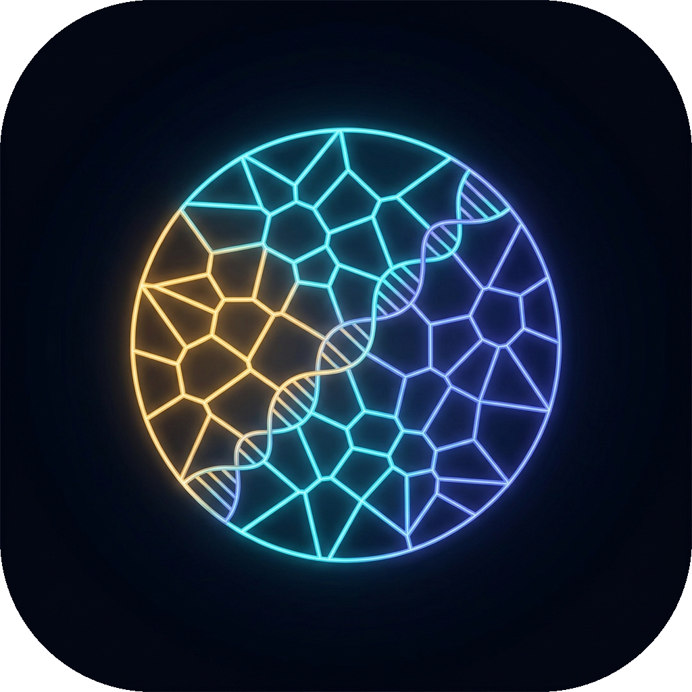

# CaldasLab

Cancer ecosystems research: notes, guides and code.

## Guides

- [Bioinformatics 101](bioinfo-101.md): a short field guide for starting computational cancer genomics (setup, data formats, core analyses, statistics, good habits, where to go next).
